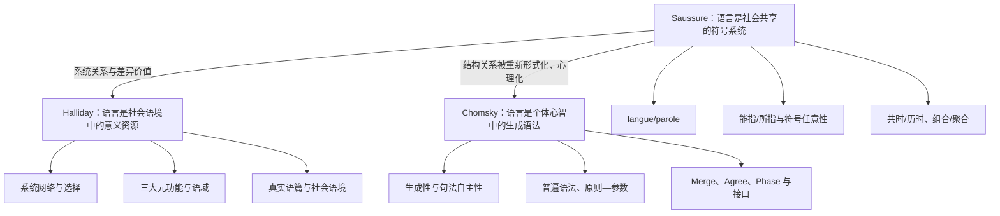
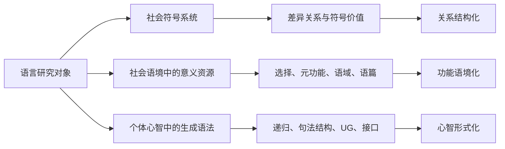

# Saussure、Halliday 与 Chomsky：语言学理论发展与研究对比地图

> **说明**：题目中的 *linguistic date* 按学术写作规范修订为 **linguistic data**，即“语言数据／语言材料／证据类型”。本地图把三位学者放在同一套分析框架中比较，但不把他们处理成可以直接互相替代的理论。

## 一、先看总图：同一个“语言”问题的三种理论化路径

这张图不是师承关系图。Saussure 为“系统、关系、共时描写”提供了现代语言学的重要基础；Halliday 沿着社会功能与意义建构方向发展出系统功能语言学；Chomsky 则把研究对象集中到说话者的心智语法、句法生成和语言能力。Halliday 与 Chomsky 都承认语言具有系统性，但“系统”在两者那里不是同一概念：Halliday 的系统是意义选择的范式网络，Chomsky 的系统是形式计算与约束机制。

## 二、七个比较维度的含义

| 维度 | 在本地图中的含义 |
|---|---|
| **发展阶段** | 理论在不同时间段解决了什么问题，代表作和新增机制是什么。阶段之间可能重叠，不能理解成一次性替换。 |
| **Scope** | 研究对象和边界：研究整个符号系统、社会语篇，还是个体心智中的生成机制。 |
| **Focus** | 某一阶段最集中处理的问题，例如符号价值、功能选择、句法生成或接口。 |
| **Terms** | 该阶段用于建模和论证的核心术语。术语的首次出现与体系化使用有时并不在同一时期。 |
| **Hypothesis** | 理论关于语言是什么、如何组织、为什么呈现某种形式的核心主张。 |
| **Methods** | 观察、描写和论证语言现象的方法。 |
| **Linguistic data** | 实际使用的语言材料和证据类型，包括文本、语料、判断数据、跨语言材料和实验材料。 |

## 三、Saussure：从历史比较到结构主义语言学

### 1. 发展阶段

| 阶段 | Scope | Focus | Terms | Hypothesis | Methods | Linguistic data |
|---|---|---|---|---|---|---|
| **1870年代—1879：历史比较语言学** 代表作：*Mémoire sur le système primitif des voyelles dans les langues indo-européennes*（1879） | 印欧语言的历史语音、词源和重建 | 解释元音交替，寻找历史系统中的对应关系 | 音变规律、比较法、重建、喉音假说雏形 | 语言变化具有系统性；表层的元音交替可以由更深层的历史音系关系解释 | 历史比较、语料对照、形式重建 | 梵语、希腊语、拉丁语、日耳曼语等历史词形与音对应 |
| **1906—1911：日内瓦普通语言学课程** | 语言作为社会性符号系统；普通语言学的对象和边界 | 区分语言系统与具体言语，建立共时／历时的双重视角 | *langage*、*langue*、*parole*；能指／所指；符号；任意性；线性；价值；组合关系与联想关系；共时／历时；符号学 | 语言不是词语的简单清单，而是由差异关系组织起来的社会共享系统；符号的价值来自系统内部的对立关系 | 共时结构描写、对立分析、组合—聚合关系分析；历史比较仍可使用，但必须和共时分析区分 | 同一语言状态中的语音、词汇、语法对立，组合关系与范式关系；法语、德语、拉丁语、希腊语及印欧比较材料 |
| **1916以后：结构主义扩展与反思** *Cours de linguistique générale*（1916，Bally 与 Sechehaye 编） | 结构语言学、音系学、符号学及其后续分支 | 把“关系”和“差异”转化为可操作的结构描写 | 音系对立、标记性、分布、符号学、结构主义 | 语言单位不能脱离系统关系单独定义；不同层次都可以通过关系和分布来分析 | 布拉格学派的音系对立、哥本哈根学派的形式化、美国结构主义的分布分析 | 音位对立、语素分布、词项组合、符号系统及跨语言结构材料 |

### 2. Saussure 的理论要点

- **语言现象的三分**：*langage* 是语言现象总体；*langue* 是社群共享的符号系统；*parole* 是具体的言语活动。*Langue* 与 *parole* 有结构上的对照，但不能直接等同于 Chomsky 的 competence 与 performance。
- **符号的双面性**：语言符号由能指与所指结合而成。二者的联系主要是社会约定的，具有任意性，但“任意”不等于所有词都毫无动机；派生、拟声和语音象征显示出相对动机。
- **价值来自差异**：一个语言单位的价值不是它孤立地“拥有”某种实体属性，而是由它与系统中其他单位的差异和关系决定。
- **共时与历时**：共时分析描写某一时点的系统状态，历时分析解释变化过程。Saussure 不是否定历史研究，而是要求两种视角不要混在一起。
- **组合与聚合**：组合关系是单位在句段中的线性连接；联想／聚合关系是同一位置上可相互替换的单位之间的关系。“聚合关系”作为固定术语主要由后来的结构主义传统推广。

### 3. 对 Saussure 的准确定位

《普通语言学教程》是 1916 年由 Bally、Sechehaye 根据课堂笔记和相关材料整理出版的死后编纂本，不是 Saussure 亲自完成的完整定稿。后来的手稿整理本 *Écrits de linguistique générale*（2002）显示，其思想比教科书式的二元对立更开放。Saussure 的贡献在于确立语言的关系性、系统性和共时描写；他的局限是没有建立一套能够像生成语法或系统功能语法那样完整运作的句法—语篇模型。

## 四、Halliday：从系统语法到系统功能语言学

Halliday 的发展不是从“没有形式”走向“只有功能”，而是逐步把形式组织、意义功能、语境和社会使用放进同一个语言架构。早期的 *scale-and-category* 语法后来转向以系统、选择和实现关系为中心的系统功能语言学（SFL）。

| 阶段 | Scope | Focus | Terms | Hypothesis | Methods | Linguistic data |
|---|---|---|---|---|---|---|
| **1955/1959—1963：Scale-and-Category 起步** *The Language of the Chinese “Secret History of the Mongols*（1959）；“Categories of the Theory of Grammar”（1961） | 语法形式体系、汉语历史语法、英语语调 | 确定语法描写的基本范畴和层级 | unit、structure、class、system；rank、delicacy、exponence（后来更多用 realization） | 语言描写需要一组相互规定的范畴；语法单位按层级组织 | 结构描写、层级分析、韵律和语调分析 | 《蒙古秘史》等汉语历史材料；英语语调、音高和口语材料 |
| **1964—1970：系统功能词汇语法成形** “Notes on Transitivity and Theme in English I–III”（1967—68）；“Language Structure and Language Function”（1970） | 英语小句、词汇语法和口语语调 | 解释小句如何同时承担经验、信息、人际等功能 | system network、choice、realization、transitivity、theme、mood、modality | 小句结构是系统选择的实现；一个小句可以同时实现多个功能 | 系统网络描写、范式—结构映射、语调与语法结合 | 英语小句、真实口语和录音材料；及物性、主位、语气、情态例句 |
| **1971—1978：社会符号学、社会语义与儿童语言** *Explorations in the Functions of Language*（1973）；*Learning How to Mean*（1975）；*Language as Social Semiotic*（1978） | 语言与社会、文化、教育、儿童发展和文学语篇 | 说明意义潜势如何在语境中形成，语言如何参与社会化 | social semiotic、meaning potential、context of situation、field/tenor/mode、register、socio-semantics、protolanguage | 语言是社会符号资源；语境和社会功能塑造语法；儿童是在互动中学习“如何建构意义” | 社会语义与语域分析、自然纵向儿童语料、教育和文学话语分析 | Nigel 儿童纵向语料、家庭和学校互动、文学文本、社会语域；Halliday & Hasan 的衔接研究 |
| **1985—1994：词汇语法与语法隐喻系统化** *An Introduction to Functional Grammar*（1985；1994 二版） | 完整英语功能语法、语域、体裁和科技语篇 | 把三大元功能、语篇结构和语法隐喻整合起来 | ideational、interpersonal、textual metafunction；lexicogrammar；transitivity；mood；theme/rheme；grammatical metaphor；nominalization | 意义可以通过一致式或语法隐喻式实现；形式选择会改变抽象性、技术性和权威感 | 细致的语篇—语域功能描写、跨体裁比较 | 口语和书面语、科学技术文本、教育语篇及多种真实体裁 |
| **2004—2008以后：系统网络、语料与跨语言扩展** Halliday & Matthiessen 2004；Halliday & Greaves 2008 | 系统网络、系统—结构实现关系、语调、计算和跨语言研究 | 更完整地组织系统、实现、层级和实例化关系 | stratification、realization、instantiation、cline of instantiation、system network | 语言架构是跨层次的选择网络，文本是系统在具体情境中的实例化 | 大型语料和计算描述、跨语言类型学、音系／语调分析 | 多语域语料、多语言语法、英语语调、语篇资源 |
| **2013以后：汉语类型学的晚期延展** “That Certain Cut: Towards a Characterology of Mandarin Chinese”（2013） | 普通话和汉语类型学 | 从系统功能角度解释汉语的类型特征 | characterology of Mandarin、功能类型学 | 不同语言可以用各自的功能组织方式实现意义，不能用英语句法直接作为唯一尺度 | 功能类型学、跨语言比较、汉语真实语料 | 普通话语料、跨语言对照材料 |

### Halliday 的三大元功能

| 元功能 | 要回答的问题 | 常见实现资源 |
|---|---|---|
| **概念元功能 ideational** | 语言如何表示经验、事件、参与者和逻辑关系？ | 及物性、过程类型、参与者、逻辑关系 |
| **人际元功能 interpersonal** | 说话者如何表达态度、立场、角色关系和交换功能？ | 语气、情态、评价、称呼和人称资源 |
| **语篇元功能 textual** | 语言如何组织信息，使话语成为连贯文本？ | 主位／述位、信息结构、衔接、指称、连接 |

Halliday 的重要概念是**选择—实现**：语言不是一组脱离使用环境的句子清单，而是一个可以根据语境选择意义的资源系统。语法仍然重要，但语法形式要和语义、语篇、语域一起解释。这里的“功能”不能简化成“语言有什么用途”，它是对语言内部组织方式的解释原则。

## 五、Chomsky：从转换生成语法到最简方案

Chomsky 的阶段划分需要注意重叠：扩展标准理论与 GB 并非完全替代关系，最简主义也更像一个持续修订的研究纲领，而不是一套已经封闭的单一理论。

| 阶段 | Scope | Focus | Terms | Hypothesis | Methods | Linguistic data |
|---|---|---|---|---|---|---|
| **1950—1964：早期转换生成语法** *Syntactic Structures*（1957）；LSLT 完成于1955、出版于1975 | 以英语句法为中心的形式语法 | 有限规则如何生成无限句子；为什么有限状态或纯短语结构不足 | phrase-structure grammar、transformational grammar、kernel sentence、recursion、grammaticality、generate | 自然语言不是有限状态过程的简单延伸；转换规则可把基础结构映射为不同句式，句法具有相对自主性 | 形式化规则、成分分析、构造句和句法判断 | 陈述、疑问、否定、被动、助动词倒装、关系从句、并列；“Colorless green ideas sleep furiously”体现形式合语法性和语义可解释性的区分 |
| **1965—1969：标准理论** *Aspects of the Theory of Syntax*（1965） | 句法以及句法—语义—音系接口 | 建立完整的生成语法架构，说明语言知识的心理实在性 | competence/performance、deep structure、surface structure、base component、lexicon、transformations、semantic interpretation | 基础规则和词库生成深层结构，转换产生表层结构；深层结构与核心语义关系有关，表层结构与语音实现有关 | 形式推导、语法判断、结构歧义和词汇选择限制分析 | 助动词系统、被动、疑问、否定、关系从句、名词化；“John is eager to please / John is easy to please”等结构歧义 |
| **1968/1970—1979：扩展标准理论** “Remarks on Nominalization”（1970）；“Conditions on Transformations”（1973）；“On Wh-Movement”（1977） | 句法—语义接口、结构依存和跨结构关系 | 为什么转换受限；表层结构和移动痕迹如何参与解释 | interpretive semantics、trace、wh-movement、island、Subjacency、c-command、theta-role、lexicalism | 语义解释不只依赖深层结构；转换受岛屿、局部性和词汇信息约束；移动留下可解释的痕迹 | 跨语言句法比较、最小对、岛效应、绑定、被动、名词化和长距离依存分析 | wh 疑问、关系从句、拓扑、被动、提升、控制、复杂名词短语抽取、重建和绑定现象 |
| **1979—1989：管辖与约束／原则—参数** *Lectures on Government and Binding*（1981）；*Barriers*、*Knowledge of Language*（1986） | 模块化普遍语法，解释跨语言共性和差异 | 用少数原则和参数统一多种句法现象 | Government and Binding、Principles and Parameters、X-bar、theta-theory、Case、Binding、ECP、Move-α、PRO/pro、empty category、D-structure/S-structure、PF/LF | 语言由跨语言不变的原则和有限参数组成；词汇项、论元结构、格、管辖、绑定和局部性共同限制句法派生 | 模块化形式演绎、跨语言参数比较、空范畴和结构标记分析 | 意大利语等空主语语言、英语和法语 wh 移动、被动、提升／控制、照应词与代词绑定、汉语和日语等类型材料 |
| **1990年代至今：最简方案与生物语言学纲领** *A Minimalist Program for Linguistic Theory*（1993）；*The Minimalist Program*（1995）；“Derivation by Phase”（2001） | 语言能力的计算系统、PF／LF 接口及其与一般认知和生物基础的关系 | 用最少的专门机制解释递归、移动、协议、局部性和接口可读性 | Merge、External/Internal Merge、Agree、Probe/Goal、feature、phase、Transfer、copy、Labeling、PF/LF、interface、Economy | 词汇项通过 Merge 组成表达式；派生必须满足概念—意图（CI）与感觉—运动（SM）接口的可读性；许多语言差异来自词汇特征和参数 | 形式计算、跨语言比较、接口检验、派生经济性分析；后期结合习得、处理、计算和生物语言学证据 | wh／主语移位、主谓一致、格、反身照应、重建、岛、椭圆、相位和长距离 Agree；英语、意大利语、日语、汉语等对照材料 |

### Chomsky 理论的阶段性演进

1. **从“如何生成”到“为什么受限”**：早期理论强调转换规则生成句子；扩展标准理论开始系统说明转换不能任意进行。
2. **从单一规则到模块化约束**：GB 用原则、参数、格、管辖、绑定、界限等模块组织跨语言事实。
3. **从表征到计算**：最简方案减少专门模块，突出 Merge、Agree、Phase、特征和接口条件。
4. **从英语判断到多种证据**：生成语法早期主要依赖研究者的语法判断和构造句；后期增加跨语言类型学、儿童习得、实验、处理和生物语言学材料。但具体句法论证仍然大量使用判断数据。

## 六、三者的横向研究对比矩阵

| 维度 | Saussure | Halliday | Chomsky |
|---|---|---|---|
| **Ontology／理论本体** | 社会共享的符号系统，核心是 *langue* | 社会语境中实现意义的符号资源，核心是意义潜势和系统网络 | 个体心智中的语言知识和计算系统，核心是 I-language／mental grammar |
| **Scope** | 普通语言学、语言系统、符号学；区分内部与外部语言学 | 语境—语义—词汇语法—音系／书写系统，以及语篇、体裁、教育和社会语义 | 语言能力、句法生成、普遍语法、跨语言差异及语言的生物／认知基础 |
| **Focus** | 共时系统、差异关系、符号价值、共时／历时区分 | 语言选择如何在语境中实现概念、人际和语篇意义 | 递归、结构依存、句法生成、约束、参数和接口 |
| **核心 terms** | *langue/parole*、能指／所指、符号任意性、价值、组合／聚合、共时／历时 | system、choice、realization、metafunction、transitivity、theme、mood、register、field/tenor/mode、lexicogrammar、grammatical metaphor、instantiation | competence/performance、generative grammar、deep/surface structure、transformation、UG、principles & parameters、government/binding、Merge、Agree、Phase、I-language |
| **核心 hypothesis** | 符号由能指和所指组成；单位的价值来自系统差异；语言是社会制度化的关系系统 | 语言是社会符号资源；语法是意义选择的资源；社会功能和语境参与解释形式 | 有限机制可以生成无限结构；人类具有受约束的语言能力；形式计算与接口条件解释跨语言现象 |
| **主要 methods** | 共时结构描写、对立与关系分析、组合—聚合分析；早期使用历史比较和重建 | 系统网络、功能语法、语篇／语域／体裁分析、纵向儿童语料、跨语言功能比较、语料和文本细读 | 形式化推导、母语者语法判断、最小对、结构歧义、跨语言比较、习得／处理／计算和生物语言学证据 |
| **Linguistic data** | 语音、词汇、语法对立；法语、德语、拉丁语、希腊语、梵语等历史与共时材料 | 会话、新闻、课堂、法律、科学、文学、儿童互动、语调录音、多模态和跨语域语料 | 句法判断、结构歧义、移动和岛、绑定、被动、格、空主语、儿童习得、跨语言句法范式 |
| **解释语言的起点** | 社会约定与系统内部的差异关系 | 语境中的意义选择和功能需要 | 个体心智中的形式计算和语言能力 |
| **对语言变异的处理** | 主要以系统差异和共时／历时变化来描述 | 把变异、语域和体裁看作意义资源的一部分 | 重点解释跨语言普遍性和参数差异，社会变异通常不在窄句法核心内 |

## 七、最重要的理论分歧：形式、功能与社会性

- **Saussure 的问题**：一个单位在系统中如何取得价值？语言如何作为社会共享的符号系统运作？
- **Halliday 的问题**：语言使用者如何根据情境选择意义？这些意义如何在词汇语法、语篇和语调中实现？
- **Chomsky 的问题**：说话者凭什么能够生成和理解无限多的新句子？这种能力由什么样的形式机制和先天约束支持？

因此，三者不是在回答完全同一个问题。用 Halliday 的功能语法去直接替代 Chomsky 的生成句法，或用 Chomsky 的心智语法去直接解释 Halliday 的语域变异，都会把研究对象和证据类型混在一起。

## 八、研究使用时的“地图式”选择

| 如果你的研究问题是…… | 优先参考的理论入口 | 适合的材料和方法 |
|---|---|---|
| 某个语言单位在系统中怎样与其他单位形成对立？ | Saussure—结构主义 | 共时语料、最小对立、组合／聚合关系、历时比较 |
| 某类表达如何实现经验、人际或语篇意义？ | Halliday—系统功能语言学 | 真实语篇、语域／体裁比较、系统网络、功能标注 |
| 一个句式为什么具有某种结构、限制或跨语言差异？ | Chomsky—生成语法 | 句法判断、最小对、形式推导、跨语言参数、接口证据 |
| 想解释语言形式与社会情境之间的联系？ | Halliday 为主，Saussure 作符号系统背景 | 会话、课堂、新闻、科技和制度语篇，语域与语篇分析 |
| 想解释语言能力、递归和句法普遍性？ | Chomsky 为主，Saussure 作结构史背景 | 句法范式、儿童习得、跨语言比较、实验和计算证据 |
| 想说明“结构—功能—心智”三种解释层次如何区分？ | 三者并置比较 | 同一组材料分三次编码：关系结构、功能语境、形式生成 |

## 九、参考文献：以原始文献为主

### Saussure

- Saussure, F. de. 1879. *Mémoire sur le système primitif des voyelles dans les langues indo-européennes*. Leipzig.
- Saussure, F. de. 1916. *Cours de linguistique générale*. Ed. Charles Bally & Albert Sechehaye, avec Albert Riedlinger. Paris: Payot.（死后编纂本）
- Saussure, F. de. 2002. *Écrits de linguistique générale*. Ed. Simon Bouquet & Rudolf Engler. Paris: Gallimard.

### Halliday

- Halliday, M.A.K. 1959. *The Language of the Chinese “Secret History of the Mongols”*. London: Blackwell.
- Halliday, M.A.K. 1961. “Categories of the Theory of Grammar.” *WORD* 17(2): 241–292.
- Halliday, M.A.K. 1967–1968. “Notes on Transitivity and Theme in English I–III.” *Journal of Linguistics*.
- Halliday, M.A.K. 1973. *Explorations in the Functions of Language*.
- Halliday, M.A.K. 1975. *Learning How to Mean: Explorations in the Development of Language*.
- Halliday, M.A.K. 1978. *Language as Social Semiotic: The Social Interpretation of Language and Meaning*. London: Edward Arnold.
- Halliday, M.A.K. 1985/1994. *An Introduction to Functional Grammar*. 1st/2nd ed.
- Halliday, M.A.K. & Hasan, R. 1976. *Cohesion in English*.
- Halliday, M.A.K. & Matthiessen, C.M.I.M. 2004/2014. *Halliday’s Introduction to Functional Grammar*. 3rd/4th ed.
- Halliday, M.A.K. & Greaves, W.S. 2008. *Intonation in the Grammar of English*.

### Chomsky

- Chomsky, N. 1957. *Syntactic Structures*. The Hague: Mouton.
- Chomsky, N. 1965. *Aspects of the Theory of Syntax*. Cambridge, MA: MIT Press.
- Chomsky, N. 1970. “Remarks on Nominalization.” In Jacobs & Rosenbaum (eds.), *Readings in English Transformational Grammar*.
- Chomsky, N. 1973. “Conditions on Transformations.” In Anderson & Kiparsky (eds.), *A Festschrift for Morris Halle*.
- Chomsky, N. 1977. *Essays on Form and Interpretation*.
- Chomsky, N. 1981. *Lectures on Government and Binding*. Dordrecht: Foris.
- Chomsky, N. 1986. *Knowledge of Language: Its Nature, Origin, and Use*；*Barriers*.
- Chomsky, N. 1993. “A Minimalist Program for Linguistic Theory.” In Hale & Keyser (eds.), *The View from Building 20*.
- Chomsky, N. 1995. *The Minimalist Program*. Cambridge, MA: MIT Press.
- Chomsky, N. 2001. “Derivation by Phase.” In Kenstowicz (ed.), *Ken Hale: A Life in Language*.
- Hauser, M.D., Chomsky, N. & Fitch, W.T. 2002. “The Faculty of Language: What Is It, Who Has It, and How Did It Evolve?” *Science* 298: 1569–1579.

## 十、使用这张地图时的三条提醒

1. **不要把 competence/performance 当作 langue/parole 的直接翻版。** 前者指个体心智中的语言知识与实际运用，后者指社会共享的语言系统与具体言语活动。
2. **不要把 Halliday 的“功能”理解成没有形式。** SFL 研究的是形式如何作为意义选择的实现资源，并且细致描写词汇语法、语篇结构和语调。
3. **不要把早期 Chomsky 术语直接搬到最简方案。** deep/surface structure、transformations、GB 模块与后来的 Merge、Agree、Phase 属于不同阶段，必须注明理论年代。
